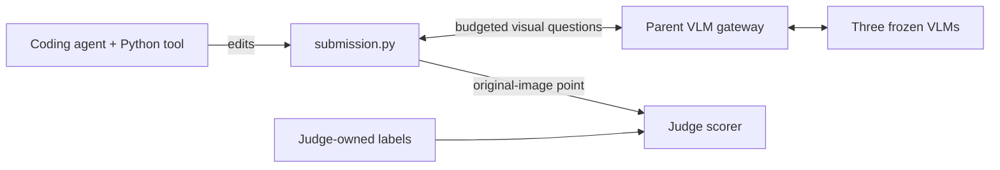

# Ensemble GUI Grounding

A task for a coding agent to improve a **single Python grounding harness** around
three frozen VLMs. The agent uses Python to design the algorithm. VLMs provide
answers and predictions through a general API; they do not write or execute Python.

Start with the [agent prompt](instruction.md), [fixed task contract](task.toml),
[API reference](docs/api.md), and [starting submission](submission.py). The repository contains the task and
reference evaluator. Experiment reports and analysis scripts are kept outside the
repository.



## Model pool

| Alias | Checkpoint | Full parameters | Intended role |
| --- | --- | ---: | --- |
| `venus` | inclusionAI/UI-Venus-1.5-2B | 2.44B | GUI grounding |
| `mai` | Tongyi-MAI/MAI-UI-2B | 2.13B | Independent grounding evidence |
| `qwen` | Qwen/Qwen3.5-2B | 2.27B | General visual questions, classification, verification, and grounding |

Exact revisions and input limits are pinned in [`models.json`](models.json).
[`configs/specialists.json`](configs/specialists.json) provides a separate Jedi
specialist variant. Select and freeze a pool before an improvement run.
These role descriptions are design choices, not performance claims.
See the [model documentation](docs/models.md) and
[coordinate-format audit](docs/model-formats.md).

The supplied serving configuration places three vLLM servers on one H100 80 GB,
using BF16, a 0.25 memory fraction each, one active sequence per server, and 16,384
positions per request. Calls are serialized. Memory fractions include executor
weights and context caches. This task revision has not been GPU-retested after the
latest pool/runtime changes.

## General VLM questions and Python decisions

```python
kind = pool.ask_vlm(
    "qwen", "Classify the requested target as text, icon, spatial, or uncertain.",
    image=screenshot,
    response_schema={
        "type": "object",
        "properties": {"kind": {"enum": ["text", "icon", "spatial", "uncertain"]}},
        "required": ["kind"],
        "additionalProperties": False,
    },
)
```

`ask_vlm` accepts arbitrary questions and Python-created images. The program can
use answers to choose models, prepare new evidence, verify proposals, or stop.
`pool.chat` supports custom conversations. `pool.ground` supplies audited native
prompts and explicit coordinate conversion as a convenience.
[`candidates/classify_then_ground.py`](candidates/classify_then_ground.py) is an
unbenchmarked example of a classification-driven decision tree. No particular
image manipulation or ensemble is imposed by the task.

## Evaluation contract

The submission exports `ground(screenshot, instruction, pool)` and returns
`{"point": [x,y]}` in original-image [0,1] coordinates, or `{"point": null}` for
an absent target. Each case permits six VLM requests, 512 output tokens per request,
and 120 seconds of submission execution. Request failures consume budget.

The parent evaluator retains labels, enforces VLM accounting, and runs each
submission in a fresh subprocess with a generic screenshot name, temporary working
directory, bounded captured output, and no inherited credentials. It kills the
process group on timeout. Exceptions and malformed predictions remain in the
accuracy denominator. Results include request traces, costs, and hashes of the
submission, model configuration, and evaluation manifest.

The subprocess boundary prevents accidental label passing; it is **not an
adversarial filesystem/network sandbox**. A production judge must isolate its
label store and model-service network separately. Held-out OSWorld-G evaluation
uses a judge-provided immutable manifest with original instructions. The task does
not download or expose those examples to the coding agent.

## Local setup

```bash
uv venv --python 3.12
uv pip install --python .venv/bin/python -e '.[cloud,data,dev]'
source .venv/bin/activate
pytest -q
gui-grounding server-commands
```

The package does not install CUDA or vLLM locally; the pinned cloud image provides
them. Evaluation expects compatible model servers on the configured loopback ports.

Prepare the pinned visible data on CPU when needed:

```bash
gui-grounding prepare-visible --output data/screenspot-pro
```

A judge manifest uses paths relative to the manifest file:

```json
{"id":"case-1","image":"images/screen.png","instruction":"Click Save","bbox_xyxy":[100,200,180,240]}
```

Boxes use original-image pixels; `null` denotes an absent target. Labels are read
only by the evaluator. Evaluate a submission into a fresh directory:

```bash
gui-grounding evaluate data/visible.jsonl --output results/candidate-001
gui-grounding evaluate data/visible.jsonl --candidate candidates/classify_then_ground.py --output results/tree-001
```

## Optional H100 plumbing check

Use your authenticated Modal CLI configuration. No account-specific settings are
hard-coded. The app and H100 function are named **`ensemble-desktop-localization`**.

```bash
modal run modal_app.py --download-only
modal run modal_app.py --skip-download
```

The first command caches pinned models on CPU. The second explicitly starts a
bounded H100 check of model requests, general classification, context handling,
and the submission/evaluator path. It records memory and request logs. It is a
plumbing check, not a benchmark analysis, and is never started automatically by
local tests. Servers bind to loopback; there is no public endpoint or always-on
service. Reports are saved to local `outputs/` and the named results volume.
